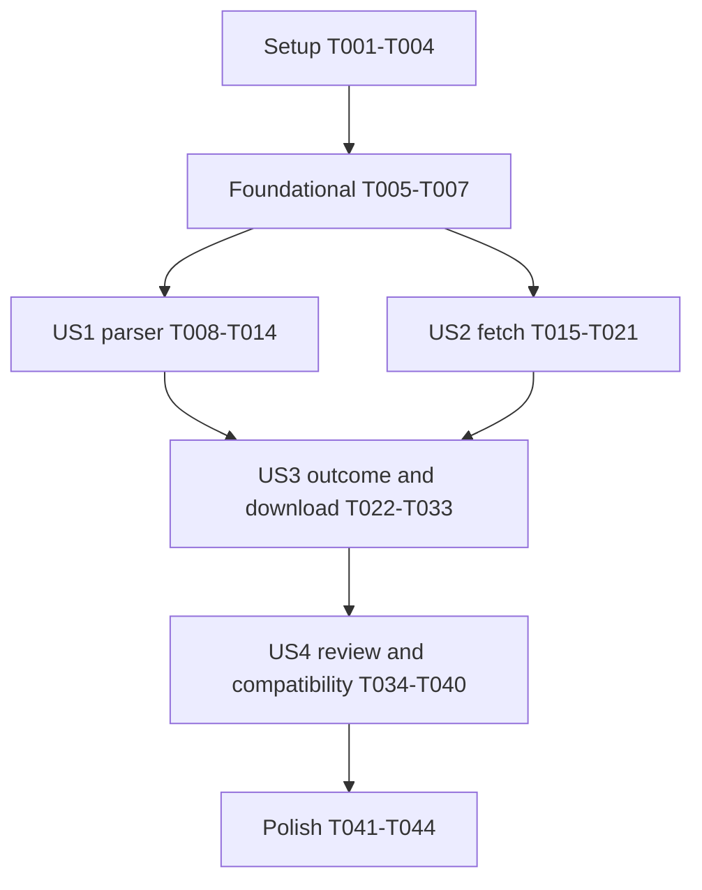

# Tasks: Исправление получения и разбора словаря PuzzleMovies

**Input**: Design documents from `specs/007-fix-dictionary-parsing/`.
**Prerequisites**: [plan.md](plan.md), [spec.md](spec.md), [research.md](research.md), [data-model.md](data-model.md), [contracts/export-and-review.md](contracts/export-and-review.md), [quickstart.md](quickstart.md).
**Created**: 2026-11-04. **Implemented and verified**: 2026-11-09; результаты и ограничения — quickstart.md.

**Tests**: Включены явно по FR-V01–02 и acceptance scenarios спецификации. Тестовые задачи выполняются перед соответствующим production code; ожидаемые результаты независимы от проверяемого парсера. Процент покрытия кода не измерялся, JaCoCo этой командой не добавляется.

## Format: `[ID] [P?] [Story] Description`

Каждая задача — checkbox + последовательный T-ID, optional [P] и обязательный [USn] в story phases. [P] означает разные файлы и отсутствие зависимости между задачами конкретной группы после её prerequisites; это не разрешение выполнять задачи до предыдущих фаз. Все описанные пути относительно корня репозитория. Выполненные implementation tasks отмечены ниже по фактическим результатам.

## Path Conventions and Global Constraints

Production: `src/main/java/com/puzzlemovies/export/`; tests: `src/test/java/com/puzzlemovies/export/`; fixtures: `src/test/resources/puzzlemovies/`; UI: `src/main/resources/`.

Java 21 и текущий Spring Boot/JPA/PostgreSQL/Jsoup/lingua стек. Без новых runtime dependencies, H2, schema/data migrations, новых persisted status values и второго CLI/export pipeline. Сохранить normalization, semantic dedupe, matcher, card identity, manual overrides, scheduling/history и two-column TSV. Parsed source остаётся transient. Не сохранять пароли/cookie в коде, fixtures или отчётах; исходные пользовательские HTML не изменять и не коммитить целиком.

Согласовано: partial допускается при ошибках отдельных records после полного fetch с exact rejected count до dedupe, а по уточнению 2026-11-09 также при стабильном расхождении счётчика после полного обхода с отдельными declared/retrieved counts; обе операции доступны после warning. Пустой словарь проверяется на реальной обезличенной оболочке с явно искусственным zero-data case. Реально пустой аккаунт и непустой inline WORD template не объявлять проверенными.

## Phase 1: Setup — исходные материалы и тестовый каркас

**Goal**: Подготовить обезличенные реальные источники и независимые ожидания без изменения приложения.

**Independent Test**: Fixtures читаются offline; provenance различает реальное наблюдение и искусственный край; ожидаемые поля не вычисляются DictionaryParser.

- [X] T001 [P] Создать `src/test/resources/puzzlemovies/words-real.html` из исходного вложения и `src/test/resources/puzzlemovies/words-expected.json` с независимо сверенными полями всех 36 строк spec.md: порядок, оригинал, перевод и отсутствие примера. Сохранить hidden/visible структуру и `to`/артикли; исключить секреты, tracking и персональную оболочку; оригинальные пользовательские файлы не менять.
- [X] T002 [P] Создать `src/test/resources/puzzlemovies/phrases-real.html` из phrases.html и `src/test/resources/puzzlemovies/phrases-expected.json` для всех 36 оригиналов, переводов и доступного movie/source context; вручную сверить первые две точные пары и `/films/cars-3-2017` из research.md, сохранить inline text-node punctuation. Не использовать результат проверяемого парсера как эталон.
- [X] T003 После T001–T002 подготовить `src/test/resources/puzzlemovies/pages/` и `src/test/resources/puzzlemovies/edge-cases/` с provenance в `src/test/resources/puzzlemovies/README.md`: обезличенные реальные промежуточные/последние страницы доступных разделов по разрешённому read-only доступу; отдельно помеченные производные multi-page цепочки, zero-count shell, malformed rows, overlap selectors и inline WORD context. Реальный пустой аккаунт и непустой inline WORD образец не объявлять наблюдавшимися; секреты не сохранять.
- [X] T004 Создать `src/test/java/com/puzzlemovies/export/support/DictionaryFixtureLoader.java` для HTML/независимых JSON expectations и `src/test/java/com/puzzlemovies/export/support/DictionaryHttpTestClient.java` с очередью HTTP responses/exceptions и записью безопасных request URI для offline client tests; использовать существующий Jackson/JUnit, не вызывать production parser при загрузке ожиданий и не печатать request headers.

**Checkpoint**: Завершать фазу только с подтверждённым результатом её проверок; создание тестов не равно их прохождению.

---

## Phase 2: Foundational — общие контракты источника

**Goal**: Закрепить компактные transient типы и инварианты, общие для раздельных проверок загрузки и разбора.

**Independent Test**: Конструирование page/raw/result объектов возможно без сети; rejected source positions считаются уникально и отдельно от final TSV rows.

- [X] T005 Добавить failing contract tests в `src/test/java/com/puzzlemovies/export/export/DictionarySourceModelTest.java`: source position различает набор/страницу/строку, одинаковый текст разных позиций сохраняется, count rejected positions не равен числу issues, accepted+rejected=sourceRecordCount; optional translations/examples/movie могут отсутствовать. Проверить до реализации T006–T007.
- [X] T006 Создать `src/main/java/com/puzzlemovies/export/puzzlemovies/DictionarySection.java` и `src/main/java/com/puzzlemovies/export/puzzlemovies/DictionaryPage.java` с PageInspection (вложенный record): section, requested page, safe sourceUri, HTML, selected section/total/current/next и shell/auth recognition. Следовать data-model.md; никаких cookie/password полей, новых persisted сущностей или enum values ExportStatus.
- [X] T007 Создать `src/main/java/com/puzzlemovies/export/export/SourcePosition.java`, `src/main/java/com/puzzlemovies/export/export/SourceExample.java`, `src/main/java/com/puzzlemovies/export/export/RawDictionaryEntry.java`, `src/main/java/com/puzzlemovies/export/export/ParseIssue.java`, `src/main/java/com/puzzlemovies/export/export/DictionaryParseResult.java`; реализовать инварианты T005 и интерфейсы data-model.md, хранить raw context отдельно от typed matching data. Выполнить `mvn -Dtest=DictionarySourceModelTest test` и подтвердить PASS.

**Checkpoint**: Завершать фазу только с подтверждённым результатом её проверок; создание тестов не равно их прохождению.

---

## Phase 3: US1 — Получить корректные исходные поля (P1, parser MVP)

**Goal**: Исправить извлечение полей по реальной разметке, сохранив строки и точную диагностику без HTTP-зависимости.

**Independent Test**: На offline HTML получить 36 WORD и 36 PHRASE raw records в порядке источника; первые пары строго по эталону; missing optional fields не удаляют запись. Partial download из US1.8 проверяется интеграционно в US3.

- [X] T008 [P] [US1] Добавить failing tests в `src/test/java/com/puzzlemovies/export/export/DictionarySourceFieldsTest.java`: все 36 WORD source/translation/order по independent JSON до нормализации/dedupe, `to mince`/`смягчать`, `a doofus`/`придурок`, 36 absent examples, hidden original не повторяется, перевод не входит в original, unrelated table не создаёт записи.
- [X] T009 [P] [US1] Добавить failing tests в `src/test/java/com/puzzlemovies/export/export/DictionaryPhraseSourceTest.java`: все 36 PHRASE ожиданий; `Man, heck of a win!` и `You don't mince words around here, do you?` без искусственных пробелов у пунктуации; phrase translation отдельно, первая ячейка movie/source не становится original, relative movie href корректно разрешён.
- [X] T010 [P] [US1] Добавить failing tests в `src/test/java/com/puzzlemovies/export/export/DictionaryParseAccountingTest.java`: отсутствие translation/example/movie, непустой производный inline context с отдельными доступными полями, две одинаковые самостоятельные записи, повторный reach той же DOM row, повреждённый original и неизвестная page shape; multiple issues одной позиции дают один rejected count, all-rejected не EMPTY. Неподтверждённые inline subfields не выдумывать.
- [X] T011 [US1] Реализовать `parseSourceEntries(DictionaryPage)` в `src/main/java/com/puzzlemovies/export/export/DictionaryParser.java`: ограничить обход dictionary table, различать WORD visible original/translation и PHRASE English/Russian/metadata, сохранить существующие текстовые узлы/пунктуацию и порядок. Inline example хранить как отдельный SourceExample, не превращать в saved phrase или новую matcher association; пересекающиеся selectors не обходят строку дважды.
- [X] T012 [US1] Добавить `parseWordPages(List<DictionaryPage>)` и `parsePhrasePages(List<DictionaryPage>)` в `src/main/java/com/puzzlemovies/export/export/DictionaryParser.java` с DictionaryParseResult, accepted raw entries и safe issues; сохранить existing normalization/fallback правила, учитывать любой rejected typed record без молчаливого continue. Не удалять старые вызываемые entry points до миграции callers в T020/T039.
- [X] T013 [US1] Перевести `src/test/java/com/puzzlemovies/export/export/DictionaryParserTest.java` на новые result contracts, сохранив проверки нормализации/metadata и добавив проверку, что отсутствие необязательных полей не создаёт rejection; исключить тестовые facades, скрывающие issues.
- [X] T014 [US1] Выполнить `mvn -Dtest=DictionarySourceModelTest,DictionarySourceFieldsTest,DictionaryPhraseSourceTest,DictionaryParseAccountingTest,DictionaryParserTest test`; записать результаты и сверку 36/36 в `specs/007-fix-dictionary-parsing/quickstart.md`. Отделить parser MVP от готовности всего web-экспорта.

**Checkpoint**: Завершать фазу только с подтверждённым результатом её проверок; создание тестов не равно их прохождению.

---

## Phase 4: US2 — Получить все страницы нужного набора (P1)

**Goal**: Получать правильный WORD/PHRASE набор и все страницы до подтверждённого окончания, без успешного усечения.

**Independent Test**: Queued responses проверяют client/inspector без vocabulary parser; все страницы и raw row counts согласованы, ошибки первой/последующей страницы не возвращают успешную накопленную часть.

- [X] T015 [P] [US2] Добавить failing tests в `src/test/java/com/puzzlemovies/export/puzzlemovies/DictionaryPageInspectorTest.java`: active section/count, current page, structural next/terminal, посторонняя подстрока page=, known zero shell, signed-out HTML 200, unknown shell, positive total с нулём rows, gaps/cycles/changed total. Терминальные expectations опирать на provenance pages, а искусственную пустоту маркировать.
- [X] T016 [P] [US2] Расширить `src/test/java/com/puzzlemovies/export/puzzlemovies/PuzzleMoviesDictionaryClientTest.java`: точные query параметры item/noredirect/page без дублей, соответствие response section, multi-page порядок и terminal stop без запроса лишней пустой страницы; отдельный набор из 51 страницы проходит без лимита 50. Не вызывать DictionaryParser.
- [X] T017 [P] [US2] Создать `src/test/java/com/puzzlemovies/export/puzzlemovies/PuzzleMoviesDictionaryFailureTest.java`: HTTP 503 на странице 1 и последующей, IOException/InterruptedException, auth HTML, blank body, wrong-section (words вместо phrases), repeated page identity, cross-origin/gapped continuation и смена total. Проверить safe section/page/status и отсутствие тестовых sentinel secrets в сообщениях; interruption flag восстанавливается.
- [X] T018 [US2] Создать `src/main/java/com/puzzlemovies/export/puzzlemovies/DictionaryPageInspector.java` с `inspect(section,pageNumber,html)` и `src/main/java/com/puzzlemovies/export/puzzlemovies/PuzzleMoviesDictionaryException.java` для safe categorized source failures; распознавать только подтверждённую shell/tab/paginator структуру, count source rows до field parsing. Пустоту отличать по known authorized shell+correct section+total=0+zero rows без противоречащего продолжения.
- [X] T019 [US2] Изменить `src/main/java/com/puzzlemovies/export/puzzlemovies/PuzzleMoviesDictionaryClient.java`: возвращать List<DictionaryPage>, явно запрашивать `/dictionary?item=word|phrase&noredirect=&page=N`, проверять каждый ответ инспектором; следовать current+1 на разрешённом origin, сверять total/aggregate source rows, удалив успешный fixed cap=50. По согласованному уточнению FR-L07 declared total не ограничивает число страниц: стабильное расхождение после полного обхода передаётся в отдельное предупреждение. Повтор/противоречие/неразрешённое продолжение дают ошибку, non-200/blank не являются концом.
- [X] T020 [US2] Согласовать новые типы страниц и parser result calls в `src/main/java/com/puzzlemovies/export/service/ExportService.java`, `src/test/java/com/puzzlemovies/export/export/ExportTestFixtures.java`, `src/test/java/com/puzzlemovies/export/service/ExportServiceTest.java` и `src/test/java/com/puzzlemovies/export/web/WebExportTestFixtures.java`; сохранить существующие export type rules. До реализации partial в T027 любой rejected record явно завершает job неуспешно, а не маскируется FULL; убрать эту временную консервативную ветку только вместе с устойчивым partial handling.
- [X] T021 [US2] Выполнить `mvn -Dtest=DictionaryPageInspectorTest,PuzzleMoviesDictionaryClientTest,PuzzleMoviesDictionaryFailureTest,ExportServiceTest test`; записать результаты в `specs/007-fix-dictionary-parsing/quickstart.md`. Подтвердить независимость от vocabulary parser и отсутствие потерь/технических повторов в многостраничных cases.

**Checkpoint**: Завершать фазу только с подтверждённым результатом её проверок; создание тестов не равно их прохождению.

---

## Phase 5: US3 — Различать отсутствие данных и сбой (P1)

**Goal**: Довести классификацию результата до пользователя: FULL/EMPTY, fetch/structure/auth failure и допустимый partial parse с устойчивым warning/count перед скачиванием.

**Independent Test**: Service/MVC tests на controlled inputs отличают четыре состояния; partial marker переживает очистку persistence context/restart boundary, warning/count видны в SSR и polling, failed fetch никогда не открывает download.

- [X] T022 [P] [US3] Создать failing tests в `src/test/java/com/puzzlemovies/export/service/ExportCompletionMetadataCodecTest.java`: FULL/legacy без marker, PARTIAL count>0, семейство DICT_META_ с unknown version, malformed JSON, missing/fractional/negative count и ноль без counter-warning и лимит существующего поля; metadata не показывается как errorMessage и не деградирует в FULL.
- [X] T023 [P] [US3] Расширить failing cases в `src/test/java/com/puzzlemovies/export/service/ExportServiceTest.java`: full/approved-empty/mixed-partial/all-rejected, exact unique rejected count до dedupe, первая/последующая 503/auth/structure failure, write/final-save failure. Проверить согласованную публикацию COMPLETED/path/metadata/rowCount, отсутствие доступного cache/file при неудаче и сохранение raw context без новых matcher associations.
- [X] T024 [P] [US3] Создать failing MVC tests в `src/test/java/com/puzzlemovies/export/web/ExportCompletionWebTest.java`: status DTO completeness/count/warning/availability, SSR без JS, full/partial direct download, пер-session/per-job warning presentation и fingerprint change, 401/404/409, missing file, corrupted marker, file available при lost review cache; warning должен предшествовать действию, внутренний JSON не выводится.
- [X] T025 [P] [US3] Создать PostgreSQL Testcontainers test в `src/test/java/com/puzzlemovies/export/repo/ExportJobCompletionPersistenceTest.java`: сохранить/перечитать существующий ExportJob с partial metadata и очистить persistence context; warning/count восстанавливаются codec, legacy не переписывается, schema и persisted status values прежние. Для этого тестового контекста отключить legacy SQL initialization (`spring.sql.init.mode=never`); никаких H2 или применения data-repair SQL к пользовательской БД.
- [X] T026 [US3] Создать `src/main/java/com/puzzlemovies/export/service/ExportCompletionInfo.java` и `src/main/java/com/puzzlemovies/export/service/ExportCompletionMetadataCodec.java`: единая проекция FULL/PARTIAL, trusted warning/count, `DICT_META_V1:` envelope в существующем errorMessage; fail closed для всего неизвестного/повреждённого marker family. FULL/legacy без marker работают по прежнему допуску, без утверждения о новой валидации старых данных.
- [X] T027 [US3] Реализовать partial accounting/publication в `src/main/java/com/puzzlemovies/export/service/ExportService.java` и `src/main/java/com/puzzlemovies/export/service/GeneratedExportData.java`: подтверждённый пустой словарь (sourceRecordCount=0) → COMPLETED/FULL с rowCount=0; complete fetch+some accepted/rejected → usable partial; исходные записи есть (sourceRecordCount>0), но все отклонены → FAILED; fetch/auth/shape failure → FAILED. По FR-L07 успешный обход с расхождением счётчика даёт отдельный usable partial warning. Сохранять immutable app-owned records/raw context/review source, публиковать metadata/path/status/count совместно после записи; на final-save failure не выдавать cache и убирать только новый artifact этого job. Не менять dedupe/matcher/formatter алгоритмы.
- [X] T028 [US3] Добавить общую owner-checked completion/availability projection в `src/main/java/com/puzzlemovies/export/service/ExportService.java`, вывести её в status и SSR через `src/main/java/com/puzzlemovies/export/web/ExportController.java`; добавить session helper `src/main/java/com/puzzlemovies/export/web/ExportWarningPresentation.java`, привязанный к job id и metadata fingerprint. SSR показа partial warning регистрирует presentation, bare status polling не считается показом; DTO не раскрывает storage envelope.
- [X] T029 [US3] Изменить `src/main/java/com/puzzlemovies/export/web/ExportDownloadController.java` на общую projection: FULL по прежнему, PARTIAL после warning presentation скачивается; прямой partial URL без presentation → 303 на progress без TSV bytes. Failed/invalid metadata/missing file недоступны, владелец проверяется; тип/имя/two-column TSV прежние.
- [X] T030 [US3] Обновить `src/main/resources/templates/progress.html`: SSR trusted warning и exact count до обеих кнопок, distinct partial label, availability по projection вместо raw COMPLETED/errorMessage. Подготовить постоянные warning/error DOM nodes и корректную видимость действий при refresh без JS.
- [X] T031 [US3] Обновить `src/main/resources/static/js/progress.js`: отобразить projection из polling, вставить warning/count до действий и отличить partial от full; остановить polling по terminal status. Для partial, появившегося во время polling, перейти один раз на SSR progress для регистрации presentation; не создавать redirect loop, не считать arbitrary client flag подтверждением показа.
- [X] T032 [US3] Выполнить `mvn -Dtest=ExportCompletionMetadataCodecTest,ExportJobCompletionPersistenceTest,ExportServiceTest,ExportCompletionWebTest test`; устранить расхождения codec/projection/SSR/download и записать фактический результат в `specs/007-fix-dictionary-parsing/quickstart.md`. Не отмечать PostgreSQL durability проверенной при пропуске контейнерного теста.
- [X] T033 [US3] Проверить реальное выполнение polling/refresh/direct-download потока в браузере на контролируемом partial test scenario: исходная running страница без warning → partial → SSR warning → обычное скачивание; кнопки и count доступны без JS, после refresh и без redirect loop. Записать доказательства и ограничения в `specs/007-fix-dictionary-parsing/quickstart.md`, не менять реальный словарь для создания сбоя.

**Checkpoint**: Завершать фазу только с подтверждённым результатом её проверок; создание тестов не равно их прохождению.

---

## Phase 6: US4 — Сохранить существующий учебный поток (P2)

**Goal**: Разрешить создание карточек из accepted части с предупреждением и сохранить режимы TSV, matching, identities, overrides и повторения.

**Independent Test**: Review import partial выполняется только после warning и из process-local structured source; повторный импорт идемпотентен, lost cache → existing 409; WORDS/PHRASES/COMBINED и история остаются прежними.

- [X] T034 [P] [US4] Добавить failing cases в `src/test/java/com/puzzlemovies/export/web/ReviewControllerTest.java`: partial POST до warning → 303 без import, после SSR warning → import accepted records; failed/corrupt metadata и чужой job отклоняются, no source после cache loss → прежний 409. Проверить, что предупреждение и rejected records не попадают в drafts.
- [X] T035 [P] [US4] Расширить `src/test/java/com/puzzlemovies/export/service/ExportServiceTest.java` на новых реальных fixtures для WORDS/PHRASES/COMBINED: selected source sets, saved phrases как контекст WORDS без standalone rows, combined с обоими наборами, partial count независимо от final deduped rowCount и неизменный двухколоночный TSV.
- [X] T036 [P] [US4] Расширить `src/test/java/com/puzzlemovies/export/service/ReviewCardImportServiceTest.java`: повторный импорт accepted FULL/PARTIAL drafts не создаёт duplicate active cards; manualContentOverride, content key, due/scheduling state и append-only history не меняются из-за нового способа получения источника. Не менять импортный алгоритм ради тестов.
- [X] T037 [P] [US4] Расширить `src/test/java/com/puzzlemovies/export/review/ReviewCardDraftFactoryTest.java`: исправленные source fields дают прежние first-two/source-order associations, unmatched/overflow standalone cards и word-only cards; source-only inline context не становится новой неподтверждённой связью. Использовать реальные PHRASE expectations и отдельные synthetic negative cases.
- [X] T038 [US4] Изменить только source eligibility/presentation ветку `src/main/java/com/puzzlemovies/export/web/ReviewController.java`: общая completion projection, owner check, 303 до warning без import; после presentation accepted structured ReviewExportSource обрабатывается прежними draftFactory/importService. FULL поведение и cache-loss 409 прежние, TSV не парсится.
- [X] T039 [US4] Завершить миграцию callers в `src/main/java/com/puzzlemovies/export/export/DictionaryParser.java`, `src/main/java/com/puzzlemovies/export/service/ExportService.java`, `src/test/java/com/puzzlemovies/export/export/ExportTestFixtures.java`, `src/test/java/com/puzzlemovies/export/web/WebExportTestFixtures.java` и относящихся тестах: удалить больше не вызываемые list-only parse helpers и временные adapters, скрывающие diagnostics; публичные generated-record/source accessors сохраняют текущие signatures и owner checks.
- [X] T040 [US4] Выполнить `mvn -Dtest=ReviewControllerTest,ReviewCardImportServiceTest,ReviewCardDraftFactoryTest,ExportServiceTest,DictionaryMatcherTest,VocabularyDeduplicatorTest,VocabularyNormalizerTest,ExportRecordBuilderTest,AnkiExportFormatterTest test`; зафиксировать реальный результат и совместимость в `specs/007-fix-dictionary-parsing/quickstart.md`, не ремонтируя старые карточки/SQL/library.

**Checkpoint**: Завершать фазу только с подтверждённым результатом её проверок; создание тестов не равно их прохождению.

---

## Phase 7: Polish & Cross-Cutting Concerns

**Goal**: Подтвердить полное покрытие требований сценариями и итоговый scope без изменения архитектуры.

**Independent Test**: Все обязательные проверки имеют фактический результат; отсутствие live empty account/inline WORD specimen не маскируется тестовым процентом или зелёным checklist.

- [X] T041 Проверить изменения `src/main/java/com/puzzlemovies/export/` и `src/test/resources/puzzlemovies/` на утечки sentinel/реальных credentials, cookie, токенов и сырых HTTP bodies в diagnostics/fixtures; проверить git diff на отсутствие schema/status enum/data-repair SQL/library/matching/scheduling изменений и wholesale raw HTML. Результат аудита записать в `specs/007-fix-dictionary-parsing/quickstart.md` без самих секретов.
- [X] T042 Выполнить полный `mvn test` по `pom.xml` после целевых suites, исправить относящиеся к этой задаче регрессии и записать counts/failures/skips/условия запуска в `specs/007-fix-dictionary-parsing/quickstart.md`. Не выдавать пропущенные Testcontainers/browser checks за PASS и не заявлять процент line coverage без измерения.
- [X] T043 Пройти manual flow из `specs/007-fix-dictionary-parsing/quickstart.md` через `mvn spring-boot:run`: все три режима, partial warning перед download/card creation, cache-loss download и review 409, корректное отсутствие optional данных и two-column TSV. Использовать fixtures/stubs для ошибок, не удалять/редактировать данные реального аккаунта; optional live traversal отмечать отдельно. После исправления повторить реальный HTTP-прогон через `specs/007-fix-dictionary-parsing/tools/live_smoke.py` по quickstart; сравнить с неуспешным content baseline `specs/007-fix-dictionary-parsing/live-smoke-2026-11-09.json`. Этот live runner не заменяет controlled partial browser test T033.
- [X] T044 Обновить `specs/007-fix-dictionary-parsing/quickstart.md` и `specs/007-fix-dictionary-parsing/checklists/requirements.md` фактическими результатами, provenance и ограничениями; сопоставить FR/SC с матрицей tasks.md, проверить все обязательные сценарии. Закрывать checkbox этой задачи только после необходимых проверок, не по факту наличия документов.

**Checkpoint**: Завершать фазу только с подтверждённым результатом её проверок; создание тестов не равно их прохождению.

---
## Dependencies & Execution Order

### Phase and Story Graph

- Линейный безопасный порядок: T001–T044. Все story tests могут исполняться offline с подготовленными источниками/контрактами.
- После foundation US1 extraction и US2 tests/inspector/client могут разрабатываться независимо. T020 интегрирует новые parser contracts и потому требует T011–T013 и T019; T021 после T020. Не обещать независимость одновременных изменений ExportService.
- US3 требует завершённых US1/US2 и реализует пользовательскую часть partial download из US1.8; parser MVP отдельно не является завершённым web release.
- US4 требует US3 projection/presentation/caches. Review tests T034–T037 независимы друг от друга, implementation T038 следует за ними. T039 следует за T038 и актуальными callers; T040 завершает интеграцию.
- T005 → T006 → T007; тестовый contract может сначала падать на отсутствующих типах, но до завершения T007 должен доказывать заявленные инварианты, а не только компиляцию.
- В story phases сначала зафиксировать meaningful failing expectations, затем implementation, затем PASS целевого набора. Verification tasks не исполняют implementation и не закрываются без вывода соответствующего запуска.

### Parallel Examples per Story

| Story | Безопасная группа после prerequisites | Что не распараллеливать |
| --- | --- | --- |
| US1 | T008, T009, T010: три разных test files после T007 | T011/T012 меняют DictionaryParser последовательно; T013/T014 после них |
| US2 | T015, T016, T017: inspector/client/failure tests в разных файлах после T007 | T018 → T019 → T020 → T021; T020 ждёт parser contracts US1 |
| US3 | T022, T023, T024, T025: codec/service/MVC/PostgreSQL test files после US1+US2 | T026 → T027 → T028; затем T029 download, T030 SSR и T031 JS последовательно из-за общего presentation contract; T032/T033 после них |
| US4 | T034, T035, T036, T037: review MVC/export/importer/factory tests после US3 | T038 controller → T039 caller migration → T040 regression |

В setup T001 и T002 используют разные HTML/expectation файлы. T003 ждёт обе реальные основы, T004 — fixture manifest. Parallel examples описывают возможную организацию работ, а не выполненный запуск агентов.

## Requirements and Test Coverage Map

Это трассировка запланированных проверок, не отчёт о фактическом test/line coverage.

| Требования / outcomes | Tasks | Проверяемый результат |
| --- | --- | --- |
| FR-P01–02, SC-001 | T001–T002, T008–T009, T011–T014 | 36 WORD и 36 PHRASE, independent fields/order, hidden duplicate excluded, punctuation/артикли сохранены |
| FR-P03–04, SC-002–003 | T002–T003, T009–T013 | Реальные saved phrases и metadata отдельно; optional fields не удаляют records; synthetic inline case помечен и не заменяет реальное наблюдение |
| FR-P05, SC-004 | T010–T012, T015–T021 | Same row один раз, одинаковый текст разных rows сохранён; ordered multi-page без потерь/повторов |
| FR-P06, SC-008 | T010, T022–T033 | Exact rejected count, допустимый partial, warning перед download; unknown page/all-rejected не empty success |
| FR-L07 | T045–T049 | Стабильное расхождение после всех страниц: отдельные section/declared/retrieved, rejected count не увеличивается; warning до обеих операций и после restart |
| FR-L01–02 | T003, T015–T021 | Явный item/query, response section, structural terminal/total и более 50 страниц |
| FR-L03–05, SC-005–006 | T015–T027, T029, T032 | 503/сеть/auth/blank/unknown/out-of-range/cycle/changed total дают явную ошибку; approved empty отдельно |
| FR-L06 | T001–T004, T017, T022–T025, T028, T041 | Safe diagnostics/context и отсутствие credentials/raw responses |
| FR-V01–02 | T001–T004, T008–T010, T015–T017 | Реальная обезличенная основа, независимые expectations; fetch и parse тестируются отдельно |
| FR-V03, SC-007 | T035–T037, T039–T044 | Три режима и two-column TSV, текущие matching/identity/history/override rules, без миграций |
| FR-V04, SC-009 | T024, T028, T030–T031, T034–T040 | Partial review после warning, только accepted structured source, owner isolation и lost-cache 409 |

US1 independent acceptance: offline source/result equality; US2: queued page sequence и safe failures без field parser; US3: status/SSR/download matrix с durable warning и различением empty/auth/fetch/shape; US4: import + export mode/TSV compatibility без изменения review rules.

## Implementation Strategy

### MVP First

T001–T014 дают parser MVP: исправление подтверждённой разметки с реальным regression corpus и диагностикой. Это можно показать и проверить независимо от сайта, но нельзя объявлять весь web-поток исправленным до US2/US3. Первая безопасная пользовательская поставка экспорта — US1+US2+US3; согласованное создание карточек из partial завершается US4.

### Incremental Delivery

Сначала independent fixtures и raw extraction; затем fetch correctness/structure; затем durable partial и warning/download; затем review eligibility и совместимость; в конце full suite и manual UI. Не ослаблять приёмку ради зелёных старых тестов; не менять алгоритмы вне scope. Реальную неподтверждённую разметку не достраивать догадками.

### Verification Record

Основные команды и ожидаемые исходы — в quickstart.md. При реализации записывать фактические results/failures/skips и оставшиеся ограничения; минимальный отчёт должен отдельно показать parser, client, service/metadata, MVC/review, PostgreSQL durability и browser polling. Full live traversal не обязателен для offline regression и не выполняется скрыто как изменение аккаунта. Каждая отметка задачи подтверждается её собственным deliverable/check.

## Notes

Before/after tasks hooks отсутствуют при генерации: `.specify/extensions.yml` не найден. Выполнение приложения, написание production/test code, создание fixtures, миграций и измерение code coverage не входят в текущую команду.

## Approved follow-up tasks — 2026-11-09 (FR-L07)

- [X] T045 Добавить независимую проверку полного обхода со стабильным расхождением счётчика и реальных строк; убрать равенство total как обязательное условие успешного получения, сохраняя строгие transport/auth/structure/changed-total failures.
- [X] T046 Добавить SourceCountDiscrepancy, отдельный rejected count, backwards-compatible V1 codec и durable warning без изменения БД; проверить round-trip, некорректные значения и PostgreSQL reload.
- [X] T047 Проверить service/status/SSR warning gate для counter mismatch с нулём parse rejections и для сочетания причин; доступные записи разрешены для TSV/review после предупреждения.
- [X] T048 Повторить полный JUnit suite, controlled counter-warning browser/restart flow и реальный экспорт + создание карточек; сохранить фактические counts и отличия от baseline.
- [X] T049 Обновить plan/spec/research/data-model/contracts/quickstart/checklist и отчёт проверки по согласованному уточнению. Не объявлять источник полным при несовпадении counter.

Final verification: 49/49 tasks complete, including FR-L07 extension. Full JUnit160/0 failures/0 errors/0 skipped on disposablePG; actual controlled browser + API/restart flows and final real-account content smoke PASS. Exact commands, independent expectations, source-counter caveat and observational limits are recorded in quickstart.md and validation reports. Literal Maven app-launch command was replaced by isolated equivalent JAR/test-classpath launchers for repeatable cleanup, as documented; no user's library/database was touched.
